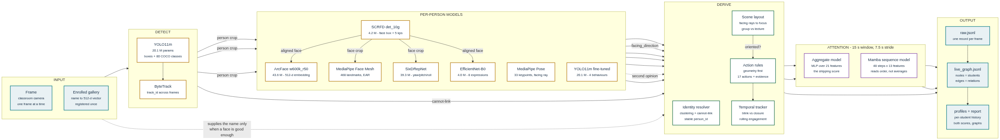
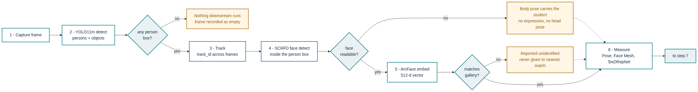
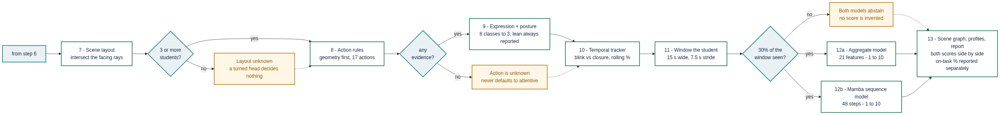

# ClassGraph

**Per-student engagement from a single fixed classroom camera.**

One frame goes in. For every student visible, what comes out is: who they
are, what they are doing, which way they are facing, and an attention score
on a 1–10 scale aggregated over 15-second windows — plus a scene graph
relating students to each other and to the objects they handle.

Nine models, of which three are trained here. Every number below is measured
against hand-labelled ground truth and reproducible from `results/`.

---

## Start here

**[docs/SETUP.md](docs/SETUP.md)** — clone to working dashboard: install,
what to download, the three ways to run it, and the errors people actually
hit.

### 1. Install

```bash
git clone https://github.com/pranayr710/cv.git classgraph && cd classgraph
python -m venv .venv && .venv\Scripts\Activate.ps1   # or: source .venv/bin/activate
pip install -r requirements.txt && pip install -e .
classgraph doctor                      # what this machine is missing
```

A clone is **6 MB** and needs no data to start — the public weights
(YOLO11m, InsightFace, SixDRepNet, the expression model, ~410 MB) download
themselves on first use.

### 2. Run the web interface

```bash
python -m tools.run.server
```

Then open **<http://127.0.0.1:8000>** and paste the access token it printed
in the terminal. That is the whole user interface: register students, start a
camera session, upload a video and watch it being analysed, see the live
overlay and the scene graph, and open the finished report.

```
ClassGraph dashboard -> http://127.0.0.1:8000
  access token: 7f3a9c2b1e...        <- paste this into the page
```

To fix the token instead of reading a new one each run:

```powershell
$env:CLASSGRAPH_TOKEN = "classgraph"   # PowerShell
export CLASSGRAPH_TOKEN=classgraph     # bash
```

> `classgraph serve` does the same thing. `uvicorn tools.run.server:app
> --factory` also works, but cannot print the token.

### 3. Everything else

```bash
classgraph video --dir <folder of clips> --out outputs/run1   # recorded footage, no browser
classgraph live                                               # webcam, no browser
classgraph train                                              # refit the attention model
pytest                                                        # 743 tests
```
---

## How it works

The system is a **chain**, not a model. Each stage narrows the question the
next one has to answer, and every stage can decline.

### The architecture



Read it left to right.

**Input.** A frame, plus the enrolled gallery — a name attached to a
512-dimension face vector, registered once per student. The gallery supplies
a *name*; it never decides *whether* two boxes are the same person.

**Detect.** YOLO11m finds every person and every object in the frame at once.
It is run with a deliberately low object threshold, because raising it to cut
false positives also loses real laptops; the display marks weak detections
rather than the detector discarding them. ByteTrack then links each box to
the same box in the previous frame, giving a `track_id`.

**Per-person models.** Everything here runs *inside* a person box rather than
over the whole frame, which is what makes the cost scale with students rather
than with resolution. SCRFD finds the face; ArcFace embeds it; MediaPipe Pose
gives 33 body keypoints including the shoulder direction; Face Mesh gives 468
facial landmarks for eye and mouth geometry; SixDRepNet gives head yaw, pitch
and roll; EfficientNet-B0 classifies facial configuration; and the fine-tuned
YOLO11m detects the four classroom behaviours.

**Derive.** This is where measurements become claims, and it is the part that
is ours rather than borrowed.

* *Identity resolver* — clusters the face embeddings into people, under a
  hard constraint: two boxes alive in the same frame **cannot** be the same
  person. Face similarity alone cannot hold a roster, because at classroom
  distance two students reach 0.6–0.8 cosine of each other.
* *Scene layout* — intersects every student's shoulder direction to find the
  point the room is collectively facing. If the rays converge outside the
  seating it is a lecture; inside it, group work. This is what makes
  "looking away" meaningful without assuming where the teacher stands.
* *Action rules* — geometry first, seventeen actions, each carrying the
  evidence that produced it. A phone must be *in a hand*, not merely present
  in the student's box; testing only for overlap reported anyone with a phone
  on their desk as using it.
* *Temporal tracker* — separates a momentary signal from a sustained state.
  A blink is not closed eyes; a glance away is not disengagement.

**Attention.** Two models score the same 15-second window. One reads 21
aggregate features; the other reads 48 timesteps in order. Both reach the
report, because they measured as a statistical tie and picking one would be
presenting a coin flip as an answer.

**Output.** Three files: `raw.jsonl` (one record per frame, matching
`schema.json`), `live_graph.jsonl` (the scene graph — students as nodes,
relations as edges), and the profiles plus an HTML report.

### The workflow

The same path in execution order, split where measuring ends and concluding
begins.

**Perception — steps 1 to 6.** Everything here is something a model measured.



The amber boxes are the point. Each gate has a path for the case where the
stage before it produced nothing: a student whose face is turned away is
still carried by body pose, and a face that matches nothing is reported
unidentified rather than assigned to whoever it resembles most. This is why
the system returns a usable result on footage where individual models fail,
which is most real classroom footage.

**Interpretation — steps 7 to 13.** Everything here is a decision about those
measurements.



Three refusals are visible in it. Below three students no room layout can be
fitted, so a turned head decides nothing. With no evidence the action is
`unknown`, never `attentive`. And below 30% window coverage both scorers
abstain rather than guessing from a handful of frames.

---

## The data

Four sets, each answering a different question. None of them is in the clone
— a clone is 6 MB of code — so this is both what the sets *are* and what to
download before retraining anything. Every count and size below is measured
on disk, not estimated.

### Where each file sits

```
dataset/
  behaviour_merged/          the behaviour detector's training set, 144 MB
    data.yaml                  4 classes; paths relative to this file  [tracked]
    train/images/              877 .jpg
    train/labels/              877 .txt, one per image -- 6,091 boxes
    val/images/                58 .jpg
    val/labels/                58 .txt -- 271 boxes
  high-2636(2191-2347)/      157 source clips, 1080p, ~27 min, 1,019 MB
  lecture_2636/              a byte-identical copy of the above; only one is needed

labeling/                    the hand labels -- the JSON here IS tracked
  labels.json                605 windows: 298 on, 259 off, 48 unclear     [tracked]
  manifest.json              the same windows' features and rule verdict  [tracked]
  recheck.json               127 of them re-judged blind -> the ceiling   [tracked]
  scores.csv, scores.json    350 images hand-scored 1-5                   [tracked]
  images/                    the pixels those labels point at, 1.8 GB
    Final Dataset 256/
      Final Dataset 256/       12,582 engagement images, foldered by class
    calibration/               the 350 hand-scored ones, 5 MB
    _duplicates/               3,418 near-duplicates, rejected not deleted
    p<id>_<start_ms>/          one folder of crops per labelled 15-s window
    1/                         DIPSER -- third party, not ours to redistribute
```

### What each one is

**`dataset/behaviour_merged/`** is a standard YOLO set: an image, and a
same-named `.txt` holding `class cx cy w h` normalised to the frame. Four
classes, in the id order `data.yaml` fixes:

| id | class | boxes |
|---|---|---|
| 0 | `read` | 1,303 |
| 1 | `sleep` | 1,553 |
| 2 | `using_device` | 2,294 |
| 3 | `write` | 1,212 |

It is two independently collected classroom sets merged by
`tools/data/merge_behaviour_datasets.py`, and the merge is the part worth
explaining. The first set labels every visible student; the second labels
only notable behaviour and leaves attentive students unboxed. Merged as-is,
that teaches the model an attentive student is background. Dropping
`look_forward` — which the pipeline discards anyway, because calibrated head
pose measures orientation far better (F1 63.2% against the detector's 25.0%)
— dissolves the conflict and grows the set 4.9×. The split is held out **by
source video**, never by frame: frames from one clip are near-duplicates of
each other, and a frame-level split would put the same desk on both sides.

**`dataset/high-2636(2191-2347)/`** is the source footage — 157 clips,
`view2191.mp4` through `view2347.mp4`, one lecture from one fixed camera.
Every engagement window, every label, and the scene graph both attention
models are fitted from comes out of this recording.

**`labeling/`** holds the only thing in the project that cannot be
regenerated, which is why its JSON is tracked in git while its images are
not — `labeling/prepare_package.py` rebuilds the crops from the pipeline
outputs plus the clips, but nothing rebuilds a human judgement.

A window id is `p<person_id>_<start_ms>`: `p14_246000` is person 14 at
4 min 6 s. The same id names the folder of crops, the entry in `labels.json`
and the entry in `manifest.json`, so the three can never drift apart.

```json
"p1_0": {
  "person_id": 1, "start_ms": 0, "end_ms": 15000, "scene": 0,
  "label": "on",             // "on" | "off" | "unclear"
  "rule_verdict": "off",     // what the rules concluded -- for comparison only
  "features": [ 1.0, 0.533, 0.467, ... ],        // 21 numbers
  "feature_names": [ "coverage", "frac_on_task_action", ... ]
}
```

`manifest.json` carries those features and the rule's own verdict, and a
labeller **must not read it** before deciding — it exists so finished labels
can be compared against what the rules already thought, not so the rules can
be copied. `recheck.json` is one line per re-judged window, and it is where
κ = 0.261 and the 0.770 ceiling in the table below come from.

**`labeling/images/Final Dataset 256/`** is a public image set foldered
`Engagement|Disengagement / age band / gender`, which is what makes a binary
label available per image. `scores.csv` adds a human 1–5 score to 350 of
them; the folder label is binary and so can train a classifier but cannot
calibrate a scale. `_duplicates/` holds the 3,418 near-duplicates
`tools/data/dedupe_images.py` pulled out — kept rather than deleted, because
the gap between 0.968 and the honest 0.664 *is* those files.

**`labeling/images/1/` is DIPSER** (Marquez-Carpintero et al., CC BY 4.0),
read only by `tools/evaluate/dipser_agreement.py` to measure how far four
expert raters agree with each other. It is 1.2 GB, it is **not ours**, and it
is excluded from the uploads below.

### What the models actually read

| | |
|---|---|
| `outputs/final2/live_graph.jsonl` | 1,782 frames of scene graph, 37 MB. Both attention models are fitted from this, never from video directly |
| `models/` | the three trained scorers — aggregate, solo, sequence. Kilobytes, **tracked** |
| `results/` | one JSON per measurement, **tracked**. Every number in this README is in here |
| `outputs/` | whatever a run produces. Disposable, gitignored |

### What to upload to Kaggle

Three archives, split by licence and by risk rather than by convenience:

| | Contents | Size | Visibility |
|---|---|---|---|
| 1 | `dataset/behaviour_merged/` + `runs/behaviour/merged4_aug/weights/best.pt` | ~185 MB | Public |
| 2 | `labeling/images/`, **excluding `1/`** | ~230 MB | **Private** |
| 3 | `dataset/high-2636(2191-2347)/` | ~1,019 MB | **Private** |

Archives 2 and 3 show identifiable students. `docs/PRIVACY_AND_ETHICS.md`
commits this project to India's DPDP Act 2023 — purpose limitation and
guardian consent — and a public download link is neither. Upload both as
**Private** and share them by Kaggle username with the people who need them.

---

## What was built

Roughly in the order it happened.

**Perception.** Nine models wired into one pass, each run only where it can
help: face models inside person boxes, pose only where shoulders are visible.
Detection validated against hand-labelled frames rather than assumed.

**Identity.** A resolver that holds one id per student across a session,
using clustering under a cannot-link constraint rather than nearest-neighbour
matching. Audited rather than claimed: the known failure — over-counting,
13–18 ids for 8 people — was measured, narrowed to re-identification across
temporal gaps, and is stated in the limits rather than hidden.

**Behaviour.** A YOLO11m fine-tune on 6,091 boxes merged from two
independently collected classroom datasets, after the first attempt was
rejected for a label-definition conflict between them.

**Engagement labelling.** A local labelling tool, 557 hand-labelled
15-second windows, and 350 images hand-scored on a five-point scale — then a
blind re-judging of 127 of those windows to measure how repeatable the labels
actually are. That measurement produced the ceiling every accuracy in this
project is reported against.

**Attention scoring.** A window-level model over 21 features, trained and
evaluated out-of-fold grouped by student. Then a sequence model over the same
windows read frame by frame. Then the measurements that made both honest: an
out-of-range gate so neither scores footage it was not fitted on, and Platt
calibration so a 1–10 score stops claiming precision the model does not have.

**Scene graph and reporting.** Students as nodes, four edge types, exclusive
object ownership, and an HTML report built from the graph. Class-level trends
by default; individuals only on deliberate drill-down.

**The dashboard.** The whole flow in a browser: register, run, watch, read
the report. Including video upload, which runs the two-pass batch pipeline
rather than the live loop, because identity is only decidable once the whole
recording has been seen.

**Making it installable.** `pip install`, a CLI, a Docker image, token auth
on every route, an encrypted face gallery, a single-command erasure across
all three stores, and a SQLite session history. A classroom system holds
biometric data about minors; these are the properties it needs before it can
be installed anywhere.

**Measuring, continuously.** 743 tests. Every number quoted is reproducible
from `results/`, and four of the fourteen reports there record something that
did *not* work.


## Three rules that explain most of the output

* **It abstains.** When a model cannot answer, the system says so rather than
  substituting its best guess. An unrecognised student is reported as
  unidentified, never as the nearest match; a window too sparse to judge is
  left unscored.
* **Nothing rests on one frame.** Every verdict is windowed over 15 seconds.
* **It does not infer emotion.** It classifies observable facial
  configuration. (Barrett et al. 2019; EU AI Act Art. 5(1)(f).)

---

## Where it stands

All figures out-of-fold and grouped by student, so no student appears on both
sides of a split.

| | Measured |
|---|---|
| **Attention score** | **0.717 accuracy, 0.708 macro F1, 0.830 off-task recall** on 82 twice-confirmed labels, against a majority baseline of 0.671 / 0.402 / **0.000** |
| **Label ceiling** | **0.770** — the most a perfect model could score, given that re-judging 127 windows blind gave κ = 0.261 and ~23% label error. 0.717 is **93%** of it |
| Student detection | P 82.2% / R 90.6% / F1 86.2% |
| Behaviour detector | mAP@50 0.607 overall; `write` **0.767**, `read` 0.419 |
| Image engagement scorer | **0.664** held out by near-duplicate group — *not* the 0.968 a random split reports |
| Face recognition, close range | 0.978 against a held-out photo, 0.032 against a stranger |
| Headcount | **over-counts**: 13–18 ids for 8 real people. Per-student figures are sound per id; the roster is not |

### The ceiling is the number that matters

0.717 is not "72% of the way to a solved problem". Re-judging the same
windows blind produced a different answer a third of the time, so roughly a
quarter of the labels are wrong, and **no model scored against them can
exceed 0.770**. The remaining gap is bought with better annotation, not a
better model.

### What was tried and did not win

Kept in the record rather than dropped, because a result that did not hold is
the only evidence that the ones that did were not luck:

| | |
|---|---|
| Mamba sequence scorer | 0.592 against the MLP's 0.609 — a tie on 179 labels |
| Vision Mamba on 12,582 images | 0.618 against ResNet18's 0.664 |
| Self-training, label spreading, 9 of 12 literature features | no gain that survived fold permutation |

The one change that helped was **peer context** — what the rest of the room
is doing — which was worth more than any architecture tried.

The Mamba scorer now **runs alongside** the shipping model rather than being
filed away. Both score every window and both numbers reach the dashboard,
because "statistically tied" is a reason to show two answers, not to pick
one. They share a window, a stride, a coverage gate and a 1–10 mapping, so a
difference between them is a difference in judgement and never in arithmetic.

### Two things the models refuse to do

* **Score footage they were not fitted on.** The attention model carries the
  per-feature range of its training set. On a one-person webcam session,
  three of its twenty-one features do not exist — there are no peers, and a
  room focus needs three students — so it declines instead of extrapolating.
* **Claim a confidence they have not earned.** Out of fold the raw model
  claimed >90% certainty on 65% of windows and was right on 60% of those, so
  the probability is Platt-calibrated before it becomes a score. Calibration
  error 0.339 → 0.035.

---

## Reproducing it

None of this is needed to *run* the system. A clone plus `pip install` does
that, and the trained scorers ship in `models/`. This is the path from the
raw sets above back to the numbers in the table above.

### Before starting

| | |
|---|---|
| Public weights — YOLO11m, InsightFace, SixDRepNet, expression | automatic on first use, ~410 MB |
| Kaggle archives 1–3 | unpacked to the paths in **Where each file sits** |
| A GPU | optional everywhere except the behaviour fine-tune, which is impractical without one |

Then check the machine before spending an evening on it:

```bash
classgraph doctor     # every dependency, weight, camera, and the free disk
pytest                # 743 tests; model-backed ones skip rather than fake a pass
```

### The order, and why it is an order

```bash
# 1. the behaviour detector            (archive 1; GPU; ~2 h)
python -m tools.train.train_behaviour

# 2. the scene graph everything else is fitted from   (archive 3)
classgraph video --dir "dataset/high-2636(2191-2347)" --out outputs/final2

# 3. the attention model, 21 aggregate features, grouped out-of-fold
classgraph train

# 4. the three steps that make that model honest
python tools/train/stamp_model_range.py    # record the fitted per-feature range
python tools/train/fit_calibration.py      # Platt map, fitted nested out-of-fold
python tools/train/train_solo_model.py     # the 18-feature small-room fallback

# 5. the sequence model, and its own calibration
python -m tools.train.train_mamba_scorer
python tools/train/fit_mamba_calibration.py
```

Each step eats the one before it, which is why this is an order and not a
menu. Step 2 writes `outputs/final2/live_graph.jsonl`; steps 3 to 5 all read
it, and none of them touches the video again. Step 4's first two tools write
*into* the model file step 3 produced — the range, then the calibration —
and a model missing either does not fail loudly: it extrapolates onto
footage it was never fitted for, or reports a confidence it has not earned.
That is the failure this project spent the longest finding, so the two tools
are listed as steps rather than as options.

The labels are the exception. `labeling/labels.json` is hand-made and
nothing above regenerates it. To add more:

```bash
cd labeling && python label_gui.py
```

Read `labeling/LABELLING_RULE.md` first, and before every sitting rather
than only the first. That rule is the only thing in the repository that can
move the 0.770 ceiling; no model change can.

### Checking you got the same answer

Every tool above writes a JSON report into `results/`, and the figures in
**Where it stands** are read from those files rather than typed into this
page. After a retrain:

```bash
python -m tools.evaluate.trusted_eval      # against the 82 twice-confirmed labels
cat results/window_model_report.json
```

Expect small movement — the folds are grouped by student and the label sets
are small — and read a large jump as a bug rather than as a win. Four of the
fourteen reports in `results/` record something that did *not* work, and they
are kept deliberately: a result that failed is the only evidence that the
ones that held were not luck.

---

## Layout

```
backend/      the pipeline: detection, identity, actions, attention scoring
tools/        78 scripts, grouped by what you would open one for — tools/README.md
  run/          what you run to use the system (server, batch, report, enrol)
  train/        fitting the models and the improvement loop
  evaluate/     measuring against ground truth
  diagnose/     one-off investigations; each answers a question
  data/         building and maintaining the label and image sets
  assets/       images and charts for the decks
classgraph/   the installed CLI (classgraph serve / video / live / train)
models/       the three trained scorers the system loads at runtime (tracked)
results/      the measurement behind every number above (tracked)
outputs/      what a run produces — disposable, gitignored
tests/        743 tests; model-backed ones skip cleanly rather than faking a pass
docs/         setup, plans, literature review, privacy, per-person work split
ppt/          deck builders; the decks are written to the root
schema.json   the frozen per-frame output contract
graph_schema.json   the scene-graph contract
```

---

## Where to look

| | |
|---|---|
| **[docs/SETUP.md](docs/SETUP.md)** | install, run, troubleshoot. Start here |
| **[docs/PART1_PLAN.md](docs/PART1_PLAN.md)** | what is delivered, the decisions and why, limitations stated plainly |
| **[docs/CHALLENGES_AND_SOLUTIONS.md](docs/CHALLENGES_AND_SOLUTIONS.md)** | every bug found, how it was verified, the measurement behind every number |
| **[docs/PRIVACY_AND_ETHICS.md](docs/PRIVACY_AND_ETHICS.md)** | EU AI Act Art. 5(1)(f), India DPDP, retention, consent, access control |
| **[docs/DEPLOYMENT.md](docs/DEPLOYMENT.md)** | installing somewhere that is not this machine; Docker |
| **[docs/LITERATURE_REVIEW.md](docs/LITERATURE_REVIEW.md)** | the research behind each open decision |
| **[labeling/LABELLING_RULE.md](labeling/LABELLING_RULE.md)** | how a window is judged on or off task — the rule the ceiling depends on |
| **[results/README.md](results/README.md)** | which tool rewrites each report, and which number it holds |
| **Work split** | [Person A](docs/WORK_PERSON_A.md) · [Person B](docs/WORK_PERSON_B.md) · [Person C](docs/WORK_PERSON_C.md) |

Base papers: ARG (Wu et al., CVPR 2019) contributes an architecture;
RDFER (Liu, Wang & Shen, T-BIOM 2025) and Dynamic Objectives Learning
(Wen et al., TMM 2020) contribute methods. The level of adoption is stated
per paper in the review deck rather than implied.

---

## Known limits

Stated here rather than discovered later:

* **The roster over-counts.** 13–18 ids for 8 real people, narrowed to
  re-identification across temporal gaps. Per-student figures are sound per
  id; the headcount is not.
* **Peer context needs a room of five or more.** `peer_count` is `n/(n+8)`
  over the peers in frame, and the fitted minimum of 0.333 means four peers.
  Below that the full model refuses and a **solo model** fitted on the same
  windows minus the three peer features takes over, so a small room is still
  scored. It costs about 0.03 macro F1 (0.587 against 0.620 on the trusted
  labels), and any score it produced says so.
* **`read` is the weak behaviour class** (0.419). Reading and writing differ
  by what is in the hand, not by posture; the literature reports the same
  confusion with far stronger temporal models.
* **The group-activity network is implemented and untrained.** It needs a
  labelled group-engagement corpus that is not publicly available.
* **Annotation reliability caps everything at 0.770.** Raising it is the
  single highest-value next step; nothing else can be shown to help until it
  moves.
